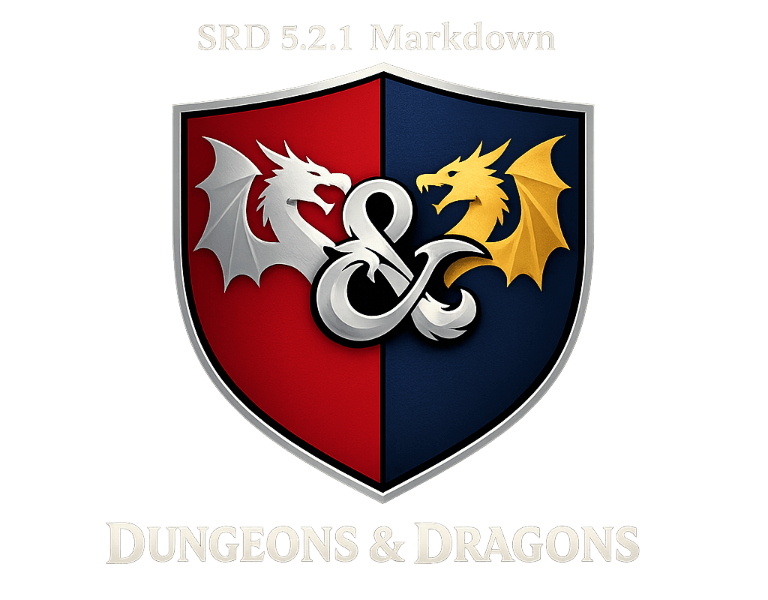

---

# D&D 5.5E SRD — Edición en Español

Conversión completa del **Documento de Referencia del Sistema (SRD) 5.2.1** de Dungeons & Dragons a formato Markdown, trabajada directamente desde el PDF oficial en español `SP_SRD_CC_v5.2.1.pdf` publicado por Wizards of the Coast. El proyecto incluye tanto la versión original en inglés (`EN/`) —basada en el trabajo de Old Man Umby y GaZmagik— como la versión en español (`ES/`), con enlaces bidireccionales entre cada documento equivalente.

## Qué incluye este repositorio

- **1220 archivos en español** cubriendo todas las categorías del SRD: reglas, conjuros, monstruos, objetos mágicos, clases, dotes, equipo y más.
- Cada documento usa **wikilinks** (`[[ ]])` para navegar entre contenidos relacionados — hechizos que referencian clases, monstruos que enlazan a conjuros, etc.
- **Enlaces bilingües** entre la versión en inglés y español de cada archivo.
- Formato **Markdown plano**, ideal para sistemas de control de versiones, herramientas PKM y exportación a otros formatos.

## Cómo leer estos documentos

### Recomendado: Obsidian

Este proyecto está diseñado pensando en [Obsidian](https://obsidian.md), una aplicación gratuita de gestión de conocimiento personal que funciona sobre una carpeta local de archivos Markdown.

**¿Por qué Obsidian?**

- **Graph view** — visualiza las conexiones entre todos los documentos como un grafo interactivo
- **Wikilinks funcionales** — los `[[enlaces entre corchetes]]` se convierten en navegación con un clic
- **Búsqueda instantánea** — busca cualquier conjuro, monstruo o regla en fracciones de segundo
- **Modo de lectura y edición** — lee como una wiki o edita directamente en Markdown
- **Plugins** — complementos como Fantasy Calendar, Dice Roller o Initiative Tracker para usar el SRD durante tus partidas

Para usar este repositorio con Obsidian:

1. [Descarga Obsidian](https://obsidian.md/download) (Windows, macOS, Linux, iOS, Android)
2. Clona o descarga este repositorio
3. En Obsidian, selecciona **"Abrir carpeta como bóveda"** y elige la carpeta raíz del proyecto
4. El archivo [`ES/Espanol.md`](ES/Espanol.md) es el punto de entrada a todo el contenido en español

### Alternativas

También puedes leer y editar los archivos con cualquier editor de Markdown:

- [Visual Studio Code](https://code.visualstudio.com/) con extensiones de Markdown
- [Typora](https://typora.io) (editor WYSIWYG de pago único)

## Estructura del proyecto

```
├── ES/                          # SRD en español (desde PDF oficial)
│   ├── Espanol.md               # Punto de entrada — índice general
│   ├── ComoJugar/               # Reglas de juego
│   ├── CreacionDePersonajes/    # Creación de personajes
│   ├── Clases/                  # Clases (Bárbaro, Mago, etc.)
│   ├── OrigenesDePersonaje/     # Orígenes de personaje
│   ├── Dotes/                   # Dotes
│   ├── Equipo/                  # Equipo y armas
│   ├── Conjuros/                # 346 conjuros
│   ├── GlosarioDeReglas/        # Glosario de reglas
│   ├── HerramientasDelJuego/    # Herramientas del juego
│   ├── ObjetosMagicos/          # 278 objetos mágicos
│   ├── Monstruos/               # Monstruos (documento unificado)
│   ├── MonstruosDeLaAALaZ/      # 421 monstruos individuales
│   └── Animales/                # 95 animales
├── EN/                          # Versión original en inglés
│   └── DND.SRD.Wiki.md          # Punto de entrada en inglés
└── logo.png                     # Logo de D&D
```

## Licencia

Todo el contenido del SRD está publicado bajo la licencia [Creative Commons Attribution 4.0 International](https://creativecommons.org/licenses/by/4.0/legalcode) (CC-BY-4.0). Eres libre de usar, compartir y adaptar este material para tus propios proyectos y publicaciones, siempre que otorgues la atribución correspondiente.

Para más información sobre el SRD y las oportunidades de publicación, visita la [página oficial del SRD de Wizards](https://dnd.wizards.com/resources/systems-reference-document).

---

## Agradecimientos

Este proyecto no existiría sin el trabajo de:

- **[Old Man Umby](https://github.com/OldManUmby/DND.SRD.Wiki)** — creador del proyecto original [DND.SRD.Wiki](https://github.com/OldManUmby/DND.SRD.Wiki), quien convirtió minuciosamente el PDF oficial del SRD 5.1 de Wizards a formato Markdown, línea por línea, incluyendo todas las erratas hasta noviembre de 2018.
- **[GaZmagik](https://github.com/GaZmagik/DND.SRD.Skill)** — responsable de actualizar los archivos al SRD 5.2.1 y mejorar su estructura y formato.

Sobre esa base de archivos en inglés —adaptados y modificados para este proyecto—, el contenido en español se generó convirtiendo el PDF oficial `SP_SRD_CC_v5.2.1.pdf` de Wizards of the Coast a Markdown, segmentándolo luego con asistencia de IA en archivos individuales por criatura, conjuro, objeto mágico y regla, y aplicando revisiones manuales para corregir y afinar el resultado. A cada archivo se le agregaron enlaces cruzados bilingües con su contraparte en inglés.

---

© 2015 Wizards of the Coast. Todos los derechos reservados. Dungeons & Dragons® es una marca registrada de Wizards of the Coast. Para más información sobre Wizards of the Coast o sus marcas registradas, visita [www.wizards.com](http://www.wizards.com).

El logo de D&D y las imágenes oficiales se utilizan con permiso del [Fan Site Kit de Wizards](https://dnd.wizards.com/resources/fan-site-kit). Wizards of the Coast, Dungeons & Dragons y sus logos son marcas registradas de Wizards of the Coast LLC en Estados Unidos y otros países.
